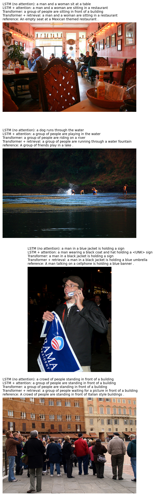
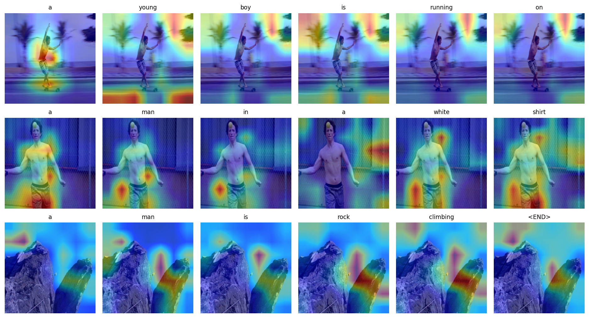
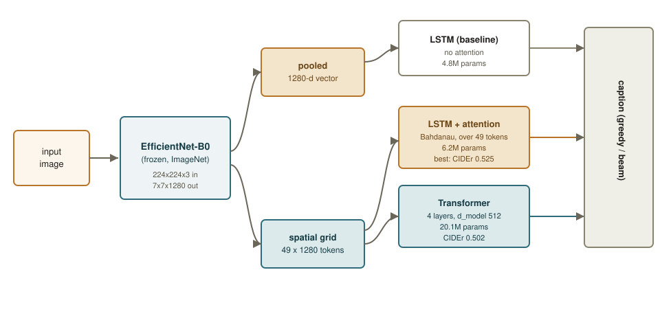

# Vision2Words

[](https://github.com/mahdisabetkish/Vision2Words/actions/workflows/ci.yml)
[](LICENSE)
[](https://hub.docker.com/r/mahdisabetkish/vision2words-app)
[](https://huggingface.co/mahdisabetkish/vision2words-decoders)

Image captioning on Flickr8k, comparing an LSTM decoder with Bahdanau attention, a Transformer decoder, and a retrieval-augmented Transformer that also reads the captions of similar training images, all on the same frozen EfficientNet-B0 features. A second retrieval-based captioner hands the retrieved captions to a small local language model instead. Behind them are a from-scratch training pipeline and a C++/ONNX Runtime inference path.

<p align="center">
  
  &nbsp;&nbsp;
  
</p>

*Left: captions from all four decoders on test-split images the models never saw during training. Right: what the attention decoder is looking at for each word it writes.*

## What this is

The original version of this repository was a Flickr8k captioning prototype with a handful of real bugs: the model was trained to reproduce its input instead of predicting the next token, "epochs" meant one batch rather than a full pass over the data, nothing ran on GPU, and the saved checkpoint was never actually loaded back for inference. This repository is a full rebuild on top of that idea: a corrected training pipeline, two additional decoder architectures trained and evaluated against the original one, a C++ inference path that doesn't depend on Python or PyTorch at runtime, a Docker/Nextflow pipeline, and a Gradio demo. Version 0.2.0 adds retrieval: a FAISS index over the training images, a decoder that reads what it retrieves, and a text-only captioner built on a local open-weights language model.

Everything below reports real, measured numbers from this codebase, not expected or typical results. If a step in the pipeline hasn't been run and verified, this README says so rather than assuming it works.

## Architecture

<p align="center"></p>

A frozen EfficientNet-B0 (ImageNet weights, never fine-tuned here) encodes each image once. Its output feeds four interchangeable decoders through a shared interface:

- **LSTM (baseline)** -- conditions on a single pooled 1280-d vector. No attention. This is the architecture closest to the original prototype, corrected.
- **LSTM + attention** -- Bahdanau additive attention over the encoder's 7x7 spatial grid (49 tokens), re-weighted at every decoding step ("Show, Attend and Tell").
- **Transformer** -- a 4-layer Transformer decoder, d_model 512, causal self-attention plus cross-attention into the same 49 spatial tokens.
- **Transformer + retrieval** -- the same decoder, except that its cross-attention memory holds the 49 image tokens followed by the captions of the four most similar training images. See Retrieval below.

Feature extraction runs once and is cached to disk (`v2w extract-features`); training reads the cache, not the raw images, which is most of why training is fast on a single consumer GPU.

## Retrieval

The retriever is an exact cosine-similarity index (FAISS `IndexFlatIP` over L2-normalised vectors) built from the pooled 1280-d EfficientNet-B0 features of the 6,000 training images, with the five human captions of each image stored next to it (`v2w build-index`). Only the training split is indexed. Validation and test images are queries and never appear in the index, so no reference caption of an evaluated image can reach the model through retrieval. During training an image would find itself first, so its own id is excluded from its results.

Two captioners use the index.

**Retrieval-augmented decoder** (`configs/transformer_rag.yaml`). For each image, one caption from each of its four nearest neighbours is tokenized with the decoder's own vocabulary, each wrapped in `<START>`/`<END>`, and appended to the 49 image tokens in the decoder's cross-attention memory. The retrieved tokens share the word embedding, get their own positional encoding plus a learned image/text segment embedding, and pass through one Transformer encoder layer; padding in them is masked out of attention. During training the caption taken from each neighbour is sampled afresh every time an example is drawn, so the decoder can't memorise one string per neighbour. Evaluation always takes the first caption, which keeps results deterministic. The idea follows retrieval-augmented captioners such as SmallCap, which put retrieved captions into a language model's prompt; here they go into the cross-attention memory of a decoder trained from scratch.

**Retrieval + language model** (`configs/rag_llm.yaml`, `v2w evaluate-rag-llm`, `v2w caption-llm`). Two captions from each of the five nearest neighbours go into the prompt of an instruction-tuned model, by default Qwen2.5-0.5B-Instruct (Apache-2.0, runs locally through `transformers`, no API key). The model never sees the image, so this measures how much of a caption can be reconstructed from what similar images were called. It is scored next to a consensus baseline that does no generation at all: the retrieved caption with the highest mean word overlap with the others (Devlin et al., 2015). The prompt (a length hint and one worked example) and the order of the captions in it were chosen on 200 validation images.

## Results

Flickr8k test split, 1000 images never seen during training. Full table and the figures above come from `v2w build-report`; raw numbers are in `results/metrics.json`.

| Decoder | Params | Decode | BLEU-4 | CIDEr | Latency (ms/img) |
|---|---|---|---|---|---|
| LSTM (baseline) | 4.8M | greedy | 0.172 | 0.443 | 15.4 |
| LSTM (baseline) | 4.8M | beam k=3 | 0.188 | 0.485 | 39.4 |
| LSTM + attention | 6.2M | greedy | 0.182 | 0.464 | 75.9 |
| LSTM + attention | 6.2M | beam k=3 | **0.202** | 0.525 | 176.0 |
| Transformer | 20.1M | greedy | 0.181 | 0.460 | 93.9 |
| Transformer | 20.1M | beam k=3 | 0.198 | 0.502 | 160.5 |
| Transformer + retrieval | 23.2M | greedy | 0.181 | 0.477 | 125.8 |
| Transformer + retrieval | 23.2M | beam k=3 | 0.200 | **0.531** | 209.2 |
| *same checkpoint, shuffled neighbours (control)* | 23.2M | greedy | 0.174 | 0.446 | 123.6 |
| *same checkpoint, shuffled neighbours (control)* | 23.2M | beam k=3 | 0.188 | 0.483 | 210.6 |

Both attention-based decoders beat the no-attention baseline on every metric, and the attention-LSTM edges out the Transformer -- a believable outcome rather than a surprising one, since the Transformer's extra parameters (20M vs 6M) have less room to pay off on a dataset this small. These numbers are also in the range published for similarly-sized models on Flickr8k, which is some evidence the pipeline is sound rather than silently broken in a way that happens to produce plausible-looking numbers.

Adding retrieval to the Transformer, with every other setting unchanged, raises CIDEr from 0.460 to 0.477 (greedy) and from 0.502 to 0.531 (beam), the best CIDEr of the four decoders. BLEU-4 hardly moves (0.198 to 0.200), and the attention-LSTM keeps the best BLEU scores. The gain is modest and each number comes from a single training run, so it should be read with that in mind. The control rows are what make it credible. They evaluate the same checkpoint, but each test image is given the neighbours retrieved for a different, randomly chosen test image. Scores then drop below the plain Transformer (CIDEr 0.483 with beam), so the decoder relies on retrieved captions that match the image, not on its extra 3M parameters.

Latency here is decoder-only, measured on the training GPU (GTX 1080 Ti); see the C++ section below for a separate, apples-to-apples Python-vs-C++ comparison. For the retrieval-augmented decoder it includes encoding the retrieved captions but not the search itself, which takes about 2 ms per query on CPU for this index.

### Retrieval + language model

Same 1000 test images, same references and metric code. None of these systems sees the image.

| System | Caption order in prompt | BLEU-4 | CIDEr | Latency (ms/img) |
|---|---|---|---|---|
| Consensus caption (no generation) | - | **0.127** | **0.348** | - |
| Retrieval + Qwen2.5-0.5B-Instruct | as retrieved | 0.102 | 0.254 | 94.7 |
| Retrieval + Qwen2.5-1.5B-Instruct | most agreed-on first | 0.100 | 0.274 | 180.2 |

Neither language model beats picking the retrieved caption that the others agree with most. In the outputs, the models mostly rephrase one or two of the retrieved captions, sometimes combining details from different neighbours into a scene none of them shows, and the rephrasing costs n-gram overlap with the references. The 1.5B model narrows the gap a little but stays well short of the baseline. All three text-only systems are far below the trained decoders, which see the image. On validation, listing the most agreed-on caption first helped the 1.5B model and slightly hurt the 0.5B one, so each run uses the order that did better for it there. Latency is generation only, batches of 16 on the GTX 1080 Ti in float32.

## Quickstart

### Python, pip

```bash
git clone https://github.com/mahdisabetkish/Vision2Words.git
cd Vision2Words
pip install -e ".[dev,export,metrics,rag]"

v2w extract-features --raw-dir data/raw --feature-dir data/features --device cuda
v2w train --config configs/lstm_attention.yaml
v2w caption path/to/image.jpg --checkpoint checkpoints/lstm_attention/best.pt --vocab data/features/vocab.json --beam-size 3
```

Retrieval (the `rag` extra installs `faiss-cpu` and `transformers`):

```bash
v2w build-index --raw-dir data/raw --feature-dir data/features --index-dir data/retrieval
v2w train --config configs/transformer_rag.yaml
v2w evaluate --checkpoint checkpoints/transformer_rag/best.pt --raw-dir data/raw --feature-dir data/features --device cuda
v2w evaluate --checkpoint checkpoints/transformer_rag/best.pt --raw-dir data/raw --feature-dir data/features --device cuda --shuffle-retrieval
v2w evaluate-rag-llm --config configs/rag_llm.yaml --out results/rag_llm.json
v2w caption-llm path/to/image.jpg --set llm.device=cpu
```

The language model downloads from the Hugging Face Hub on first use (about 1 GB for the 0.5B model). A different one is a config override away, e.g. `--set llm.model=Qwen/Qwen2.5-1.5B-Instruct --set retrieval.order=agreement`.

The dataset downloads automatically on first use (from a public Hugging Face mirror that already carries the standard 6000/1000/1000 train/val/test split) if `data/raw` isn't already populated. See `configs/` for the decoder configs and `src/vision2words/cli.py` for every `v2w` subcommand.

### Docker

```bash
docker build -f docker/Dockerfile.train -t vision2words-train .
docker run --rm --gpus all -v "$(pwd)/data:/app/data" -v "$(pwd)/checkpoints:/app/checkpoints" \
    vision2words-train train --config configs/lstm_attention.yaml
```

A second, much smaller image (`docker/Dockerfile.inference`) carries only the compiled C++ binary and ONNX Runtime -- no Python, no CUDA. See `docker/README.md`.

### Nextflow

```bash
nextflow run pipeline/main.nf -profile local,test   # a few minutes, tiny subset
nextflow run pipeline/main.nf -profile docker        # the real thing, containerized
```

`main.nf` wires the whole project together: download data, cache features, build the retrieval index, train all four decoders in parallel, evaluate each, score retrieval + language model, build the comparison report, export decoders A and B to ONNX, and benchmark the C++ port against Python. See `pipeline/README.md`.

### C++

```bash
cd cpp
./scripts/fetch_third_party.sh          # or .ps1 on Windows
cmake -S . -B build -DCMAKE_BUILD_TYPE=Release && cmake --build build

v2w export-onnx --feature-dir ../data/features \
    --lstm-attention-checkpoint ../checkpoints/lstm_attention/best.pt \
    --transformer-checkpoint ../checkpoints/transformer/best.pt --out-dir ../export/onnx

./build/v2w_caption path/to/image.jpg --model-dir ../export/onnx --decoder lstm_attention --beam-size 3
```

See `cpp/README.md` for the export strategy (the attention decoder exports differently from the Transformer, for reasons that come up specifically with ONNX) and the full build walkthrough.

## C++ inference: does it actually match Python, and is it faster?

Measured on the training machine (Windows, GTX 1080 Ti, MSVC, ONNX Runtime 1.20.1 CPU execution provider). Full writeup in `results/cpp_report.md`. The parity check re-run on Ubuntu 24.04 with the same checkpoints gives the same 12 of 16 matches.

- **Parity**: 12 of 16 test captions matched Python exactly (beam search, two decoders, 8 images). The 4 mismatches are close paraphrases, not garbage, and trace to `stb_image_resize2`'s resize filter not being bit-identical to PIL's -- the exported ONNX graphs themselves were separately verified against PyTorch to ~1e-6 precision.
- **Latency** (single image, model loaded once, mean of 50 runs):

  | Decoder | Python (CPU) | Python (CUDA) | C++ (CPU, ONNX Runtime) |
  |---|---|---|---|
  | LSTM + attention | 138.2 ms | 147.1 ms | **27.8 ms** |
  | Transformer | 221.7 ms | 202.3 ms | **182.8 ms** |

  C++ on CPU beats Python on both CPU and GPU here. That's not a GPU failing -- at batch size 1 with sequences under 20 tokens, kernel-launch and host/device transfer overhead outweighs the actual compute, while ONNX Runtime's CPU path has neither that round trip nor Python's per-step interpreter overhead.

## Gradio demo

A Gradio app ([`app/`](app/)) captions an uploaded image with the attention-LSTM, the Transformer and the retrieval-augmented Transformer side by side, and shows the attention decoder's word-by-word attention map. A Retrieval tab lists the captions of the closest training images with their cosine similarity, and can ask the language model for a caption written from them. It runs on CPU. The weights load from the public Hugging Face model repo [`mahdisabetkish/vision2words-decoders`](https://huggingface.co/mahdisabetkish/vision2words-decoders) via `hf_hub_download` on first start, so nothing large is stored in this repository.

Two ways to run it yourself:

**With Docker (no Python setup):**

```bash
docker run --rm -p 7860:7860 mahdisabetkish/vision2words-app
```

or build the image yourself with `docker build -f docker/Dockerfile.app -t vision2words-app .`.

**From source:**

```bash
pip install -e ".[app,rag]"
python app/app.py
```

Either way, open http://localhost:7860 in a browser. Set `V2W_MODEL_REPO` to load a different model repo, or `V2W_LLM` for a different language model. If the model repo has no retrieval files, the app runs with the other two decoders.

`scripts/push_model_to_hub.py` and `scripts/push_space_to_hub.py` publish the model and the app to Hugging Face. Neither runs automatically. The Docker images are published by the `Publish images` workflow (`.github/workflows/publish-images.yml`) when a version tag is pushed: it builds the demo and inference images, captions an example image through the running demo with `scripts/smoke_test_app.py`, and only then pushes `latest` and the version tag to Docker Hub.

## Training details

- **Data**: [Flickr8k](https://www.kaggle.com/datasets/adityajn105/flickr8k), 8,091 images, 5 captions each, the standard 6000/1000/1000 split (see Citation below). Never committed to this repository; downloaded on demand.
- **Vocabulary**: words appearing at least 5 times in the training captions only, 2,541 words, plus `<PAD>`, `<START>`, `<END>`, `<UNK>`. Saved as JSON next to every checkpoint.
- **Encoder**: EfficientNet-B0, ImageNet weights, frozen. 224x224 input, ImageNet normalization.
- **Regularization**: dropout, weight decay, gradient clipping, `ReduceLROnPlateau`, early stopping on validation loss.
- **Reproducibility**: every run is seeded (Python, NumPy, PyTorch), and the resolved config is saved alongside the checkpoint it produced. The decoders have no convolutions, so there's no cuDNN nondeterminism to fight either -- rerunning a config reproduces the same validation loss to the digit (checked, not assumed).
- **Hardware**: a single GTX 1080 Ti. AMP is off by default (Pascal has no Tensor Cores, so there's nothing for it to buy).
- **Logging**: CSV and TensorBoard, per run, under `checkpoints/<run>/`.

## Testing

```bash
pytest tests/ -v
ruff check src/ tests/ scripts/ app/
ruff format --check src/ tests/ scripts/ app/
```

62 tests, about 20 seconds on CPU: vocabulary round-tripping, dataset/collate shapes, forward-pass shapes for every decoder, the attention decoder's `step()` function checked against its own `forward()`, greedy and beam decoding, one-batch overfit sanity checks, and ONNX export parity. The retrieval tests check that an image never retrieves itself, that padding in the retrieved captions doesn't change the decoder's output while their content does, and the language-model captioner's prompt building and output cleaning against small stand-in models, so nothing is downloaded. GitHub Actions runs this plus a Docker build and a C++ build on every push and pull request.

## Project structure

```
src/vision2words/       the package: data, models, training, evaluation, inference
  data/                 Flickr8k download, vocabulary, feature caching, dataset/collate
  models/               four decoders behind one shared interface
  retrieval/            FAISS index, retrieved-caption context, the language-model captioner
  training/             the corrected training loop
  evaluation/           BLEU/CIDEr, decoding (greedy + beam), report/figure generation
  inference/            single-image captioning, ONNX export
configs/                YAML configs, one per decoder, plus rag_llm.yaml
tests/                  pytest suite
cpp/                    CMake project: ONNX Runtime inference, no Python at runtime
docker/                 training/eval image (CUDA) and a slim CPU inference image
pipeline/               Nextflow: the whole project, end to end
app/                    the Gradio demo (also packaged for Hugging Face Spaces)
results/                metrics.json, comparison.md, figures, the C++ parity/benchmark report
scripts/                one-off utilities: pushing to the Hub, the C++/Python parity check
```

## References

- R. Ramos, B. Martins, D. Elliott, Y. Kementchedjhieva. *SmallCap: Lightweight Image Captioning Prompted with Retrieval Augmentation.* CVPR 2023.
- J. Devlin, S. Gupta, R. Girshick, M. Mitchell, C. L. Zitnick. *Exploring Nearest Neighbor Approaches for Image Captioning.* arXiv:1505.04467, 2015.
- J. Johnson, M. Douze, H. Jégou. *Billion-scale similarity search with GPUs.* IEEE Transactions on Big Data, 2019.
- Qwen Team. *Qwen2.5 Technical Report.* arXiv:2412.15115, 2024.

## Citation

```bibtex
@article{hodosh2013framing,
  title={Framing image description as a ranking task: Data, models and evaluation metrics},
  author={Hodosh, Micah and Young, Peter and Hockenmaier, Julia},
  journal={Journal of Artificial Intelligence Research},
  volume={47},
  pages={853--899},
  year={2013}
}
```

## License

[MIT](LICENSE).
